# AgentAtom

**Type-safe, actor-driven agentic operations and structured outputs for Swift and Apple Intelligence.**

[](https://swift.org)
[](https://developer.apple.com/swift/)
[](https://developer.apple.com/apple-intelligence/)
[](LICENSE)
[](https://swift.org/package-manager/)
[](https://github.com/abhi266raj/AgentAtom/releases/tag/0.1.0)

[GitHub Repository](https://github.com/abhi266raj/AgentAtom) · [Releases](https://github.com/abhi266raj/AgentAtom/releases) · [macOS Demo](Examples/AgentAtomDemo/README.md) · [Testing & Validation](Tests/README.md) · [Contributing](CONTRIBUTING.md)

---

## Overview

**AgentAtom** is an independent Swift 6 package engineered for building reliable, deterministic AI agent workflows and structured outputs. It bridges high-level prompt specifications with on-device Apple Intelligence (`FoundationModels`) using compile-time Swift type safety.

Traditional LLM integrations rely on fragile string interpolation, regex parsing, and runtime hoping that models adhere to requested JSON formats. AgentAtom eliminates these failure modes:

- **Guaranteed Output Schemas:** Derives compliant JSON Schema and Apple native `GenerationSchema` directly from standard Swift `Encodable`/`Decodable` structs without macro constraints or `@Generable`.
- **Actor-Based Concurrency:** Runs every operation inside an isolated Swift 6 `actor`, guaranteeing thread safety, state machine tracking, and cooperative cancellation.
- **On-Device Apple Intelligence:** Native, zero-cloud, private execution on macOS and iOS via `AppleIntelligenceSession`.
- **Pristine Separation of Concerns:** System rules, roles, and schema constraints are strictly decoupled from input prompt data.
- **Model-Declared Rejection Handling:** Provides built-in patterns (`FailableAgenticOperation`) for models to explicitly report when input criteria or premises are unmet.
- **Unmodified Raw Response Preservation:** Preserves raw provider JSON without lossy auto-repairs or silent wrapper mutations; domain decoding and semantic validation remain caller-owned.

---

## Core Architecture

AgentAtom separates the agentic pipeline into three distinct layers: **Specification**, **Operation Actor**, and **Session Provider**.

```mermaid
flowchart LR
    subgraph Caller["Application Layer"]
        Spec["ModelledSpec<Input, Output>\n(Role, Rules, Schema, Input)"]
        Decoder["JSONDecoder\n(Caller Domain Validation)"]
    end

    subgraph Operation["AgentAtom Actor Layer"]
        Op["AgenticOperation / StreamingOperation\n(State Machine, Task Lifecycle, Cooperative Cancellation)"]
    end

    subgraph Session["Session Provider Layer"]
        Sess["AppleIntelligenceSession\n(SystemLanguageModel / Native GenerationSchema)"]
    end

    Spec --> Op
    Op --> Sess
    Sess -->|Raw JSON Text| Op
    Op -->|Preserved String| Decoder
```



### The Four Operation Modes

AgentAtom provides four operation actors to match your workflow requirements:

| Operation | `execute()` Result Type | AI-Declared Failure Support | Best For |
|---|---|---|---|
| `AgenticOperation` | `Result<String, AgenticError>` | ❌ No | Standard single-response structured generation |
| `FailableAgenticOperation` | `Result<String, AgenticError>` | ✅ Yes | Generations where the model can reject insufficient input |
| `StreamingAgenticOperation` | `AsyncStream<Result<String, AgenticError>>` | ❌ No | Interactive UI updates with cumulative text snapshots |
| `FailableStreamingAgenticOperation` | `AsyncStream<Result<String, AgenticError>>` | ✅ Yes | Real-time streaming with intelligent rejection reporting |

---

## Quick Start

### 1. Define Output and Specification

Conform your domain output to standard Swift `Decodable` and `Sendable`. Create a specification conforming to `ModelledSpec`:

```swift
import AgentAtom
import Foundation

// 1. Define your strongly-typed output model. No special macros required.
struct SummaryOutput: Decodable, Sendable {
    let points: [String]
}

// 2. Define the agent specification.
struct SummarySpec: ModelledSpec {
    static let identity = Identity(id: "summary-agent", name: "SummaryAgent", version: "1.0")
    static let role = "You are an analytical assistant that extracts concise key points."
    let instructions = "Return exactly three distinct points supported by the input. Never invent facts."
    let input: String
    var output: SummaryOutput?
}
```

### 2. Execute with Apple Intelligence

Initialize `AppleIntelligenceSession` and run an operation:

```swift
#if canImport(FoundationModels) && (os(macOS) || os(iOS))
@available(macOS 26, iOS 26, *)
func runSummary() async throws -> SummaryOutput? {
    // Check device, user settings, and on-device model readiness
    guard let session = AppleIntelligenceSession(configuration: .init(
        temperature: 0.2,
        metadata: [.duration, .tokenUsage, .modelIdentifier]
    )) else {
        print("Apple Intelligence is unavailable on this device.")
        return nil
    }

    let spec = SummarySpec(input: "Asha opened a library. Ben donated books. Mira hosted a reading.")
    let operation = FailableAgenticOperation(spec: spec, session: session)

    // Execute the operation
    let result = await operation.execute()

    switch result {
    case .success(let jsonString):
        // Raw JSON is preserved unchanged; decode into domain models
        let output = try JSONDecoder().decode(SummaryOutput.self, from: Data(jsonString.utf8))
        guard output.points.count == 3 else {
            print("Domain validation failed: expected 3 points, got \(output.points.count)")
            return nil
        }
        return output

    case .failure(let error):
        switch error {
        case .generationFailed(let reason):
            // Model declared that the input was insufficient or contradictory
            print("Model rejected request: \(reason)")
        case .operationFailed(let reason):
            print("Operational or schema failure: \(reason)")
        case .cancelled:
            print("Operation was cancelled.")
        case .busy:
            print("Session is currently busy with another operation.")
        default:
            print("Error: \(error.localizedDescription)")
        }
        return nil
    }
}
#endif
```

---

## Streaming and Cancellation

AgentAtom supports real-time text streaming with cumulative snapshots and cooperative cancellation:

```swift
#if canImport(FoundationModels) && (os(macOS) || os(iOS))
@available(macOS 26, iOS 26, *)
func streamSummary(spec: SummarySpec, session: AppleIntelligenceSession) async {
    let operation = FailableStreamingAgenticOperation(spec: spec, session: session)
    let stream = await operation.execute()

    for await result in stream {
        switch result {
        case .success(let cumulativeSnapshot):
            // Update your UI with the newest snapshot
            print("Snapshot: \(cumulativeSnapshot)")
        case .failure(let error):
            print("Streaming failed: \(error.localizedDescription)")
        }
    }

    // Cooperative cancellation if needed before stream finishes:
    // await operation.cancel()
}
#endif
```

> [!NOTE]
> Each stream buffers only its newest result and coalesces intermediate snapshots. Do not decode intermediate snapshots as completed domain models; decode only upon terminal success.

---

## Key Concepts & Design Rules

### 1. Separation of Instructions and Input Data
AgentAtom separates static identity, role definitions, rules, and JSON schema constraints from dynamic prompt input. This ensures consistent prompt caching, predictable token bounds, and reliable schema compliance.

### 2. Caller-Owned Domain Validation
AgentAtom intentionally **does not**:
- Auto-repair malformed JSON.
- Strip markdown fences (` ```json `) destructively.
- Inject domain rules into general framework schemas.
- Mutate `spec.output` storage automatically.

The raw generated JSON is preserved verbatim. Your application decodes the output using standard `JSONDecoder` and enforces business rules (such as result counts, enum ranges, and semantic constraints).

### 3. Model-Declared Rejection Format
Failable operations (`FailableAgenticOperation` and `FailableStreamingAgenticOperation`) introduce a standardized alternative failure schema to the provider:

```json
{
  "domain": "AgentAtom.Operation",
  "code": 422,
  "reason": "The provided input lacks sufficient facts to summarize."
}
```

When the model emits this schema, AgentAtom cleanly maps it to `AgenticError.generationFailed(reason:)`, allowing your application to handle model rejections separately from operational failures.

### 4. Actor Lifecycle and Identity
Every operation is an isolated Swift `actor` with its own process-local `ObjectIdentifier`. It tracks its execution state:
```
ready  ──>  running  ──>  completed | cancelled | failed
              │
              └──>  paused ──> running
```
Operations manage their active `Task` lifecycle directly, preventing runaway background tasks. Overlapping calls on an active operation return `AgenticError.busy`.

---

## Installation

### Swift Package Manager

In Xcode, select **File > Add Package Dependencies...** and enter:

```
https://github.com/abhi266raj/AgentAtom.git
```

Select **Exact Version: 0.1.0**.

#### In `Package.swift`:

```swift
dependencies: [
    .package(url: "https://github.com/abhi266raj/AgentAtom.git", exact: "0.1.0")
]
```

### Choose Binary or Source Product

Both products are distributed from the same repository and version `0.1.0`:

| Product | Distribution | Swift Import | Description |
|---|---|---|---|
| **AgentAtom** *(Recommended)* | Precompiled dynamic XCFramework | `import AgentAtom` | Prebuilt universal binary for Mac and iPhone. Includes linked `TypeDecoder` and module interfaces. |
| **AgentAtomSource** | Compiles directly from source | `import AgentAtomSource` | Compiles source directly within your build graph. |

In your target dependencies:

```swift
// For recommended binary XCFramework:
.product(name: "AgentAtom", package: "AgentAtom")

// Or for source compilation:
.product(name: "AgentAtomSource", package: "AgentAtom")
```

> [!IMPORTANT]
> Choose one product per dependency graph. The two products define identical APIs but distinct Swift module namespaces; do not mix imports between them.

---

## Platform & Toolchain Requirements

| Component | Minimum Version | Notes |
|---|---|---|
| **Swift Toolchain** | Swift 6.0+ | Strict concurrency and Swift 6 language mode |
| **Binary Baseline** | Xcode 26.6+ | CI-validated baseline for precompiled XCFramework |
| **Package Deployment** | macOS 14.0+, iOS 16.0+ | Declared package minimums |
| **Apple Intelligence** | macOS 26.0+, iOS 26.0+ | Requires `FoundationModels` framework and supported Apple Silicon hardware |
| **Token Usage Metadata** | Swift 6.4 / macOS 27+, iOS 27+ | Optional SDK metadata; absent on older OS versions |

---

## Interactive macOS Demo

An interactive SwiftUI demo app is included in [Examples/AgentAtomDemo](Examples/AgentAtomDemo/README.md). It demonstrates:
- Local Apple Intelligence execution with `SystemLanguageModel.default`.
- Live real-time token streaming and cumulative snapshot rendering.
- Model-declared failure handling with explanatory rejections.
- Cooperative task cancellation.

To build and run from the repository root:

```sh
# 1. Build local XCFramework for development
Scripts/build-xcframework.sh

# 2. Build the macOS demo app
xcodebuild -project Examples/AgentAtomDemo/AgentAtomDemo.xcodeproj \
  -scheme AgentAtomDemo -destination 'generic/platform=macOS' \
  -derivedDataPath .build/example CODE_SIGNING_ALLOWED=NO build
```

---

## Development & Testing

AgentAtom includes a comprehensive test suite validating session contracts, schema derivations, state machines, and concurrency safety without requiring active Apple Intelligence models.

```sh
# Build XCFramework distribution
Scripts/build-xcframework.sh

# Run deterministic unit and contract tests
swift test

# Verify both binary and source products against isolated consumers
Scripts/verify-products.sh
```

### Opt-in Live Apple Intelligence Tests

Live model tests are disabled by default. If you are running macOS 26+ on supported Apple Silicon with Apple Intelligence enabled, run:

```sh
AGENTATOM_LIVE_TESTS=1 swift test --filter AppleKeyPointsTests
```

See [Tests/README.md](Tests/README.md) for detailed test architecture and coverage.

---

## License & Notices

AgentAtom is licensed under the **GNU Affero General Public License v3.0 (AGPL-3.0-only)**. See [LICENSE](LICENSE) and [COPYRIGHT](COPYRIGHT) for details.

Third-party dependency notices (including TypeDecoder under Apache-2.0) are documented in [THIRD_PARTY_NOTICES.md](THIRD_PARTY_NOTICES.md).
